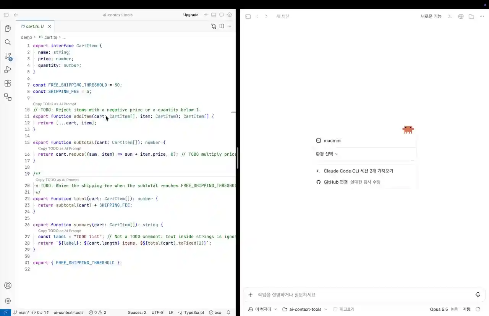

# AI Context Tools

Leave `TODO` comments while you read code, then hand them to your AI coding agent **one at a time, with exact location and clear instructions** — in one click.

Works with any agent you paste into: Claude Code, Codex, GitHub Copilot Chat, Cursor, ChatGPT, and others. Nothing is sent anywhere; the extension only writes to your clipboard.



## Why

Asking an agent to "fix all the TODOs" gives it too much scope. Writing a focused prompt by hand means copying the path, finding the line number, pasting the comment, and repeating the same instructions every time. This extension does that part for you:

- A **Copy TODO as AI Prompt** CodeLens appears above every TODO comment.
- The copied prompt contains the file path, line number, the TODO itself, and instructions to keep changes scoped, verify them, and remove the TODO when done.
- TODOs are detected with real syntax grammars for 59 languages, so `"TODO"` inside strings is ignored.

## Usage

- Click **Copy TODO as AI Prompt** above a comment containing an uppercase `TODO` word in a supported language.
- Right-click a line number and choose **Copy Path and Line** to copy a reference such as `src/example.ts:L35`.
- Both commands are also available in the Command Palette under **AI Context Tools**, using the current cursor line.
- Paste the copied text into your AI coding agent.

For a comment like `// TODO: Validate the email before saving.`, the default prompt is:

```text
Complete the instructions in the TODO at the file and line below.
Review that location and the surrounding code, keep the existing structure and style, and change only what is needed.

/your/project/src/example.ts:L35

// TODO: Validate the email before saving.

After making changes, run verification appropriate to the change.
If you completed every instruction in the TODO, delete the TODO comment. If it is a trailing comment after code, keep the code itself.
If the work is incomplete or needs further confirmation, keep the TODO and explain what remains.
When finished, briefly summarize the changes and the verification results.
```

When the editor display language is Korean (`ko`), the built-in prompt is in Korean. Set your own template to use any language or wording.

File references use `/your/project/src/example.ts:L35`. Line numbers start at 1. Copying does not modify the file or contact any AI service.

## Settings

Configure these in user or workspace settings:

```json
{
  "ai-context-tools.promptTemplate": "Do the following TODO.\n\n{file}:L{line}\n\n{todo}",
  "ai-context-tools.pathFormat": "absolute"
}
```

- **Prompt Template**: `{file}` is the file path, `{line}` is the line number, and `{todo}` is the complete TODO comment. Unknown placeholders remain unchanged. Leave it empty to use the built-in English or Korean prompt.
- **Path Format**: `absolute` (default) or `relative`. Relative paths use the containing workspace folder. Files outside the workspace fall back to absolute paths. In multi-root workspaces, open the corresponding project in your AI agent so relative paths resolve correctly.

Settings and TODO text are read when copying; changes do not require rebuilding.

## Supported comments

Standalone and inline TODOs are detected inside comments using TextMate grammars. Strings and ordinary code are excluded. `TODO` is case-sensitive, must be a separate word, and can appear anywhere in the comment, with or without a colon:

```ts
// TODO: Add validation.
const value = 1; // TODO remove this
/* TODO: Add validation. */
/**
 * TODO: Update this step.
 * This following line is not included when copying.
 */
```

Line comments (`//`, `#`, `--`, `;`, etc.) and block comments (`/* */`, `<!-- -->`, `<# #>`, etc.) follow the selected language's grammar. Only the comment portion on the TODO line is copied, preserving comment markers present on that line. Adjacent lines and surrounding code are excluded. A line receives at most one lens; if multiple separate comments contain TODOs on the same line, the first is copied.

Supported VS Code language IDs:

- Web: `javascript`, `javascriptreact`, `typescript`, `typescriptreact`, `html`, `xml`, `css`, `scss`, `sass`, `less`, `vue`, `svelte`, `astro`.
- General: `python`, `go`, `rust`, `java`, `c`, `cpp`, `csharp`, `swift`, `kotlin`, `dart`, `ruby`, `php`, `objective-c`, `objective-cpp`, `scala`, `groovy`, `zig`.
- Scripts and queries: `shellscript`, `powershell`, `bat`, `lua`, `perl`, `r`, `julia`, `sql`.
- Functional and Lisp: `clojure`, `lisp`, `common-lisp`, `emacs-lisp`, `scheme`, `haskell`, `ocaml`, `fsharp`, `elixir`, `erlang`.
- Configuration and build: `jsonc`, `json5`, `yaml`, `toml`, `dockerfile`, `makefile`, `cmake`, `graphql`, `hcl`, `terraform`, `prisma`.

Markdown, plain text, MDX, JSON, and unlisted languages have no TODO lenses or TODO copying. **Copy Path and Line** remains available for all saved files. Language selection follows the editor's language mode, including file associations, rather than the filename extension.

Grammars and the Oniguruma WASM engine are bundled for offline use and loaded when needed. Files without a TODO word skip tokenization. Analysis carries state across lines to distinguish block comments from multiline strings, stops after the last potential TODO line, and caches completed results for the document version and language. Accuracy follows the bundled syntax-highlighting grammars; it is not a full language parser. Exceptionally slow lines stop the analysis instead of returning partially classified comments.

Save untitled files before using the commands. Local files and remote workspace files are supported. Remote paths refer to the remote filesystem.

If lenses are hidden, enable the editor's **Code Lens** setting (`editor.codeLens`).

## Development and testing

```sh
npm install
npm run compile
npm run lint
npm test
```

Press **F5** in VS Code or Cursor to launch the Extension Development Host, then open a saved file containing a TODO. Verify the CodeLens and line-number menu and paste their clipboard output.

`npm test` runs integration tests in an isolated Extension Host and temporary workspace. To use an installed editor instead of downloading VS Code:

```sh
VSCODE_TEST_EXECUTABLE='/Applications/Visual Studio Code.app/Contents/MacOS/Code' npm test
# Cursor:
VSCODE_TEST_EXECUTABLE='/Applications/Cursor.app/Contents/MacOS/Cursor' npm test
```

## Package and publish

```sh
npm run package
```

In VS Code or Cursor, run **Extensions: Install from VSIX...** and select the generated `.vsix`. VS Code 1.78 or later is required.

Publish to the Visual Studio Marketplace and Open VSX (used by Cursor, Windsurf, and VSCodium):

```sh
npx vsce login iamssen
npm run publish:vsce
npm run publish:ovsx -- -p <open-vsx-token>
```
